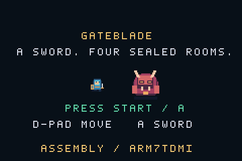

# Criando um jogo de Game Boy Advance em assembly com ajuda de IA

A ideia começou com uma regra simples: um herói entra em uma sala com uma espada, derrota os inimigos e libera a saída. Na próxima sala, o desafio se repete, até uma luta contra um chefe mais difícil.

Quis transformar essa ideia em um jogo de Game Boy Advance e documentar o desenvolvimento com apoio de IA. O resultado desta primeira versão é **Gateblade**: quatro salas, combate direcional, inimigos que perseguem o jogador, um chefe com investida, derrota, reinício e vitória.

O código executado pelo console é assembly ARM, incluindo a inicialização. As ferramentas de preparação e teste usam Python, Make e o emulador mGBA. Essa separação é importante para entender o que significa assembly puro neste projeto.

O [repositório está público no GitHub](https://github.com/AlanHJH/gba-assembly-ai). A [ROM pode ser obtida nas releases](https://github.com/AlanHJH/gba-assembly-ai/releases), e o [guia de reprodução](../docs/reproducao.md) mantém os comandos e requisitos usados na construção.

## 1. Transformar a ideia em regras pequenas

Antes de programar, o jogo precisava de um recorte que pudesse ser concluído. A proposta do herói, da espada e das saídas bloqueadas veio do pedido inicial. Nome, visão de cima, quatro salas e valores de vida foram decisões de implementação.

O herói começa com seis corações. A espada causa um ponto de dano e atinge uma área à frente do personagem. Os slimes da primeira sala precisam de dois golpes; os inimigos das salas seguintes precisam de três. O chefe tem dezesseis pontos de vida e causa o dobro do dano de contato de um inimigo comum.

As três primeiras salas têm dois, três e quatro adversários. A quarta tem o Guardião. Ao limpar uma sala, a porta ao norte abre, mas é necessário caminhar até ela para continuar. Entrar na sala seguinte recupera um coração, respeitando o limite inicial.

Esse recorte deixou inventário, equipamentos, mapas grandes e geração procedural para depois. A primeira versão precisava demonstrar uma partida completa, da tela inicial à vitória.

## 2. Escolher o alvo certo de assembly

O alvo é o **Game Boy Advance**, com processador ARM7TDMI. Não basta pedir à IA “assembly ARM”: as instruções precisam ser compatíveis com a arquitetura dessa CPU. A documentação da [Arm relaciona ARM7TDMI a Armv4T](https://developer.arm.com/community/arm-community-blogs/b/architectures-and-processors-blog/posts/arm-fundamentals-introduction-to-understanding-arm-processors), e o [Tonc apresenta o hardware do GBA](https://gbadev.net/tonc/hardware.html).

Nesta versão, o programa usa instruções ARM. O assembler recebe explicitamente `-mcpu=arm7tdmi`, para não aceitar silenciosamente instruções de processadores mais recentes. A opção é documentada pelo [GNU assembler](https://sourceware.org/binutils/docs/as/ARM-Options.html).

Assembly puro, aqui, significa que o startup, as regras, a leitura dos controles, a renderização e os efeitos sonoros próprios estão em assembly. Não usamos um jogo escrito em C com algumas rotinas assembly. Também não usamos engine ou runtime C dentro da ROM.

Isso não impede ferramentas de outras linguagens no computador. O script que empacota pixels ou fornece botões a um emulador não é executado pelo GBA.

## 3. Preparar a construção

O caminho escolhido usa três utilitários de GNU Binutils: `as`, `ld` e `objcopy`. No macOS de desenvolvimento, foi instalado o pacote `arm-none-eabi-binutils` pelo Homebrew; a versão efetivamente utilizada foi 2.44.

O Make organiza esta sequência:

```text
pixels e letras definidos em Python
            ↓
tiles e paletas binários
            ↓
assembly → arquivo objeto → ELF → binário → cabeçalho → ROM .gba
```

Na raiz do projeto, `make` executa o processo inteiro. As etapas principais são:

```sh
arm-none-eabi-as -mcpu=arm7tdmi -g -o build/gateblade.o src/main.s
arm-none-eabi-ld -T src/gba.ld -Map=build/gateblade.map -o build/gateblade.elf build/gateblade.o
arm-none-eabi-objcopy -O binary build/gateblade.elf build/gateblade.gba
python3 tools/rom.py build/gateblade.gba
```

O [script de linkedição](../src/gba.ld) posiciona código e recursos na região de ROM e o estado mutável em EWRAM. Esse é o papel do linker script: definir a disposição das seções na memória, como explica a [documentação do GNU ld](https://sourceware.org/binutils/docs/ld/Scripts.html). O [objcopy](https://sourceware.org/binutils/docs/binutils/objcopy.html) produz o binário sem a estrutura de depuração do ELF.

Por fim, `tools/rom.py` preenche os campos do cabeçalho, os bytes fixos de identificação e o checksum. O ELF permanece disponível para depuração; a saída que o jogador abre é `build/gateblade.gba`.

## 4. Inicializar o console e organizar o programa

Em um aplicativo comum, muitas decisões de inicialização já foram tomadas pelo sistema operacional ou pelo runtime. Aqui, elas aparecem no projeto.

O [startup](../src/main.s) seleciona o modo da CPU usado pelo programa, configura a pilha em RAM interna e limpa a seção `.bss`. Depois prepara vídeo, paletas e sprites e mostra o título.

O programa está dividido em poucos arquivos:

| Arquivo | Responsabilidade |
| --- | --- |
| `src/main.s` | Entrada, inicialização, espera de VBlank, controles e estado em RAM |
| `src/game.s` | Movimento, ataques, inimigos, chefe, portas e estados da partida |
| `src/render.s` | Cenário, textos, sprites e efeitos sonoros |
| `src/constants.inc` | Endereços, botões, estados e campos dos inimigos |
| `src/gba.ld` | Distribuição de código e dados na memória |

As rotinas que alteram registradores preservados pelo chamador guardam e restauram esses valores na pilha. Essa disciplina ajuda a manter chamadas previsíveis em um programa sem a organização automática de uma linguagem de nível mais alto.

## 5. Um erro que a montagem não revelou

A primeira ROM foi montada e recebeu um cabeçalho válido, mas a execução mostrou uma tela vazia. O contador de quadros do programa permanecia em zero.

A inspeção do estado da CPU revelou execução em EWRAM, embora o programa tivesse sido ligado para ROM. O mGBA havia classificado a imagem pequena como um programa multiboot. Nessa condição, a própria limpeza de `.bss` apagava parte do programa que o emulador havia carregado na RAM.

A investigação chegou à função `GBAIsMB`, no [código do mGBA 0.10.5](https://github.com/mgba-emu/mgba/blob/0.10.5/src/gba/gba.c). A heurística considera o conteúdo próximo ao offset `0xC0`, entre outras condições.

Uma primeira tentativa com um desvio de +24 nessa posição não resolveu: a análise seguinte ainda encontrava referências de RAM. A solução adotada foi colocar em `0xC0` um desvio para trás, de volta à entrada de cartucho. O início principal da ROM continua saltando para o startup correto. O projeto é uma ROM de cartucho e não oferece inicialização multiboot.

Depois da correção, o contador avançou e a tela inicial apareceu. Um teste de regressão verifica essa entrada. Foi uma demonstração concreta de que montagem, linkedição, geração de ROM e execução são verificações diferentes.

## 6. Desenhar o cenário e os personagens

Gateblade usa modo 0, um background de tiles e sprites de hardware para os personagens e a espada. Cada peça gráfica é organizada em tiles de 8 × 8, com quatro bits por pixel. As referências usadas foram os capítulos de [backgrounds](https://gbadev.net/tonc/regbg.html) e [sprites](https://gbadev.net/tonc/regobj.html) do Tonc.

O [gerador de recursos](../tools/assets.py) descreve a arte em matrizes e formas simples: piso, paredes, portas, corações, letras, herói, slimes, sentinelas, chefe e arcos da espada. Em seguida empacota os pixels e as paletas no formato usado pela ROM. Os recursos visuais não dependem de baixar sprites ou fontes de outros jogos.

Durante a inicialização, DMA3 transfere esses recursos para a memória de vídeo e para as paletas. A configuração de transferência segue o mecanismo documentado no [Tonc sobre DMA](https://gbadev.net/tonc/dma.html).

Durante a partida, o programa modifica o mapa para o HUD e a porta, e atualiza atributos na OAM para posicionar os objetos. O herói tem orientações e quadros de caminhada; dano e preparação do chefe recebem sinalização visual.

## 7. Ler os controles e atualizar uma vez por quadro

O GBA expõe os botões por um registrador de entrada. Seus bits são ativos em nível baixo: um botão pressionado aparece como zero. O programa inverte os bits e aplica uma máscara, seguindo a descrição do [Tonc sobre controles](https://gbadev.net/tonc/keys.html).

Guardamos tanto os botões atuais quanto os que acabaram de ser pressionados. Movimento e repetição da espada usam o estado atual; começar e pausar usam a transição, evitando alternar a pausa repetidamente por manter Start apertado.

O loop espera sair do VBlank atual e entrar no próximo antes de atualizar. Essa segunda condição evita executar várias atualizações no mesmo período. O teste da tela inicial observa exatamente sessenta incrementos do contador ao executar sessenta quadros do emulador.

Não há interrupção de vídeo nesta versão; usamos consulta de `VCOUNT`. É uma escolha pequena e explícita para o protótipo. O [capítulo de vídeo do Tonc](https://gbadev.net/tonc/video.html) explica as etapas de desenho e VBlank. O jogo trabalha no ritmo de quadros do GBA, próximo de 59,73 Hz, sem uma simulação de tempo variável.

## 8. Fazer a espada causar dano uma vez

Ao atacar, o herói mantém sua direção e uma caixa de 32 × 32 é posicionada à sua frente. Essa caixa é comparada com a área de cada adversário vivo. A interseção aplica um ponto de dano.

O detalhe que evita um erro comum é o identificador do golpe. A animação dura vários quadros; sem controle adicional, um adversário poderia receber dano a cada atualização durante o mesmo movimento da espada.

Cada ataque aumenta `attack_id`. Cada adversário guarda o identificador do último golpe recebido. Se os dois valores já são iguais, não recebe outro dano daquele ataque. O teste mantém um inimigo ao alcance durante a animação e confere que ele perde apenas um ponto.

O ataque tem nove quadros ativos e intervalo de vinte quadros. Durante sua parte ativa, o herói não anda nem muda a direção do golpe. Segurar A repete o ataque quando o intervalo permite. Ao receber dano de contato, o herói ganha 75 quadros de proteção, para não perder todos os corações numa única sobreposição.

A revisão também encontrou um caso de borda: se o herói tem um coração e o chefe causa dois, o resultado antes do limite é negativo. A condição de derrota precisa tratar vida menor ou igual a zero, não apenas igualdade. Isso foi corrigido e recebeu um cenário próprio no teste de derrota.

## 9. Ligar as mortes à saída da sala

Ao carregar uma sala, o jogo inicializa os adversários e o contador de inimigos vivos. Quando um inimigo passa de vida positiva para zero, o contador diminui uma vez e o total de eliminações aumenta.

Esse contador é usado tanto no desenho da porta quanto na regra de travessia. Enquanto for maior que zero, a posição do herói é limitada pela parede. Quando chega a zero, abre-se a passagem central ao norte.

O avanço ainda exige que o herói esteja alinhado com a porta e alcance sua posição. Na última sala, a mesma travessia leva à vitória. Derrotar o chefe sem alcançar a saída não encerra imediatamente a partida.

## 10. Tornar o chefe diferente

O Guardião não é só um inimigo comum com mais vida. Ele tem uma sequência de comportamento: aproximar, preparar, investir e recuperar. A preparação pisca e exibe `WARDEN IS CHARGING!`; a recuperação mostra a oportunidade de atacar.

O dano da espada não congela a sequência do chefe. Isso evita neutralizar a investida apenas mantendo o botão de ataque pressionado. Seu dano de contato é de dois corações, em vez de um.

O primeiro controlador automatizado chegou à última sala, aproximou-se demais e morreu. A correção foi na estratégia do controlador: manter alcance de espada e recuar durante preparação e investida. A vida do herói não foi aumentada por fora, e o chefe não foi removido ou enfraquecido para obter a demonstração.

## 11. Testar a ROM de verdade

Para validar o jogo, construímos o mGBA 0.10.5 a partir de um arquivo oficial com SHA-256 conferido. O frontend SDL permite jogar; o núcleo libretro permite executar a mesma ROM por um pequeno frontend Python.

Esse frontend fornece botões, recebe quadros de vídeo e consulta o mapa de memória exposto pelo emulador. Os símbolos do ELF permitem identificar o estado relevante sem adivinhar endereços.

Há dois tipos de verificação. Os cenários focados preparam situações em RAM para testar regras como dano, alcance e invulnerabilidade. A campanha completa usa somente entradas de controle. Essas duas modalidades são identificadas no código e no relatório.

Os nove grupos de teste cobrem cabeçalho e entrada, início do jogo, limites e porta fechada, pausa, espada e som, dano e proteção, derrota e reinício, ciclo do chefe e campanha completa com reinício após vitória.

O percurso completo atravessou as quatro salas, derrotou dez adversários ao todo e terminou com dois corações. A ROM validada tem 14.456 bytes; o relatório e o hash estão em [evidências](../docs/evidencias/2026-10-23/README.md). Esses resultados descrevem esta versão e este percurso, não uma avaliação de dificuldade feita por um grupo de jogadores.

## 12. Ver o resultado e reproduzir



A demonstração foi capturada dos quadros reais da ROM, com o controlador automatizado. O GIF mostra a campanha e a vitória; não é uma simulação visual feita separadamente. A ampliação preserva os pixels, e a demonstração não inclui áudio.

Para testar a partir do repositório:

```sh
make
make emulator
make verify
make play
```

Esses comandos pressupõem as dependências do [guia de reprodução](../docs/reproducao.md). Para jogar, use direcional, A e Start; no frontend SDL preparado aqui, são setas, X e Enter. Para regravar a captura, `make demo` também requer FFmpeg.

## O que a IA ajudou a fazer — e o que precisou ser verificado

A IA ajudou a transformar o pedido em uma implementação, escrever assembly, gerar recursos por script, preparar testes e organizar o relato. O processo também produziu erros concretos: expressões rejeitadas pelo assembler, configuração incompatível do frontend SDL, identificação incorreta da ROM como multiboot e uma estratégia de combate que perdia no chefe.

O que dá sustentação ao artigo não é a confiança no texto gerado pela IA, mas a ligação entre código, comandos, fontes e resultados observados. As tentativas e correções estão preservadas nas [decisões](../docs/decisoes/0003-ferramentas-e-validacao.md) e no [diário](../docs/diario/2026-10-23-implementacao.md).

Não foi feita uma comparação de tempo com e sem IA. Também não houve teste em GBA físico. A validação local foi realizada em emulador, sem fornecer um arquivo externo de BIOS.

## O que melhorar depois

A primeira versão resolve o ciclo pedido, mas ainda é pequena. Os próximos caminhos possíveis incluem obstáculos com colisão, novos padrões de ataque, música, mais variedade visual, configuração de encontros por dados e testes em console físico.

Para adicionar salas, eu começaria refatorando a configuração de inimigos. Apenas aumentar uma constante não é suficiente: a quantidade e o arranjo de adversários também precisam respeitar os limites de memória e das rotinas existentes.

A licença de reutilização do projeto ainda precisa ser definida pelo mantenedor antes de apresentar o código como uma base licenciada para outros projetos. O repositório já é público e inclui o que foi usado para construir, testar e explicar esta versão.
