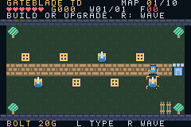
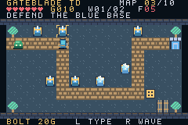
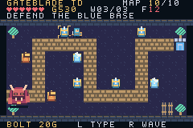

# Criando um tower defense para Game Boy Advance em assembly com apoio de IA

A proposta começou com um herói, uma espada e salas cheias de inimigos. Depois mudou: eu queria a movimentação por células dos RPGs clássicos, combinada com um tower defense. O resultado desta etapa é **Gateblade TD**: dez mapas, moedas por eliminações, três tipos de torre e uma campanha que termina ao atravessar o último portal.

O jogo executa em uma ROM de Game Boy Advance. Seu startup, as regras e a renderização foram escritos em assembly para ARM7TDMI. A IA apoiou a implementação, a criação das ferramentas e a documentação; os testes executaram a ROM no mGBA. Python prepara recursos e controla o emulador no computador, sem fazer parte do programa executado pelo console.

Este texto acompanha a versão **0.2.0**. O projeto público está no [GitHub](https://github.com/AlanHJH/gba-assembly-ai), e a [release](https://github.com/AlanHJH/gba-assembly-ai/releases/tag/v0.2.0) contém ROM, checksum, demonstração e uma cópia deste artigo. A primeira versão, de combate em quatro salas, continua preservada na [v0.1.0](https://github.com/AlanHJH/gba-assembly-ai/releases/tag/v0.1.0) e no [artigo anterior](artigo-v0.1.0.md).


## 1. Transformar a ideia em regras observáveis

O pedido definiu dez fases com mapas diferentes, uma primeira fase simples para ensinar o jogo, moedas por inimigos derrotados e torres com funções distintas. Uma decisão foi confirmada antes de implementar: as torres ficariam **ao lado da estrada, sem bloquear a passagem dos inimigos**.

A campanha adotou oito pontos de construção por mapa. O jogador anda até um deles, vira para a célula adjacente e aperta A. As torres atacam sozinhas quando os inimigos entram no alcance. R inicia uma onda, e Start pausa. O herói conserva a espada em B para ajudar na defesa.

Cada mapa tem uma base com seis pontos de vida. Brumins, criaturas fictícias criadas para o projeto, seguem uma rota fixa até ela. Um inimigo comum que chega retira um ponto; o Guardião da Névoa, presente na última onda, retira três. A vida da base chegando a zero encerra a partida.

Quando todas as ondas são resolvidas e a base continua de pé, o portal abre. O herói precisa caminhar até a saída para trocar de mapa. Essa travessia mantém a movimentação como parte da experiência, mesmo entre as defesas.

As regras completas estão no [guia do jogo](../docs/como-jogar.md). Os valores de custos, vida e recarga são escolhas desta implementação, sujeitas a testes com jogadores; não foram fornecidos como parâmetros exatos no pedido inicial.

## 2. Escolher o alvo e separar as ferramentas

O alvo escolhido foi o **Game Boy Advance**. A comparação com movimentação clássica por tiles serviu de referência de controle. Os gráficos, inimigos e mapas são originais; nenhum recurso de Pokémon foi incorporado.

A construção usa GNU Binutils para `arm-none-eabi`: assembler, linker e conversor para binário. O assembler recebe `-mcpu=arm7tdmi`. O projeto não depende de engine, libgba, GCC ou runtime C para montar a ROM.

No computador, Python gera os recursos, preenche o cabeçalho e executa os testes. O mGBA fornece a emulação. O código C do emulador é uma ferramenta externa, não código do jogo dentro do cartucho. Essa separação permite usar ferramentas práticas sem abandonar o requisito de assembly para o executável.

A configuração e os limites foram registrados em [decisões técnicas](../docs/decisoes/0003-ferramentas-e-validacao.md) e na [decisão da campanha](../docs/decisoes/0004-campanha-tower-defense.md).

## 3. Construir uma ROM mínima que realmente inicia

O startup coloca a pilha na memória interna, limpa o estado em EWRAM, inicializa o vídeo e mostra a tela inicial. O linker organiza código e dados constantes na região do cartucho. Depois, `objcopy` transforma o ELF em binário e uma ferramenta preenche o cabeçalho.

Um problema da primeira versão mostrou por que montar o assembly não basta: a ROM pequena foi identificada como multiboot pelo emulador, carregada em EWRAM e apagada pela própria limpeza de estado. A correção da entrada de cartucho em `0xC0` foi preservada na evolução para tower defense e possui teste de regressão.

A validação segue etapas distintas: montar, linkeditar, conferir cabeçalho, executar e observar o estado da partida. O [diário histórico](../docs/diario/2026-10-23-implementacao.md) preserva a investigação, incluindo as tentativas que falharam.

## 4. Descrever dez mapas como dados

Em vez de codificar cada fase diretamente em instruções, `assets/stages.json` descreve nomes, temas, quantidade de ondas e vértices das rotas. Um exemplo da primeira fase é a estrada reta entre as células `(0,3)` e `(13,3)`.

`tools/maps.py` expande cada segmento em células vizinhas e valida que o caminho é cardinal, contínuo e não cruza a si mesmo. O gerador escolhe oito pontos de construção adjacentes, fora da estrada. Uma busca em largura verifica se o herói ainda consegue atender todos os pontos quando todas as torres estão construídas e se consegue alcançar a saída.

A construção transforma esses dados em binários incluídos na ROM com `.incbin`. Não existe leitura de JSON no GBA. O assembly recebe ponteiros para mapa, rota e pontos, mais os parâmetros da fase.



Cada mapa tem 14 × 7 células de 16 pixels. A campanha passa por First Watch, River Bend, Frost Pass, Bramble Way, Amber Road, Ember Steps, Moon Cross, Glass Maze, Ashen Trail e Warden Keep. São dez geometrias, acompanhadas por cinco temas de paleta, e não dez recolorações do mesmo cenário.

## 5. Implementar movimento e interação por células

O herói mantém célula atual, destino e distância restante. Cada atualização avança dois pixels; um passo de 16 pixels leva oito atualizações. Durante esse passo, a direção não muda. Árvores, a base, torres construídas e o portal fechado bloqueiam o movimento.

Construir exige estar alinhado à grade e apontar para um ponto vizinho. O cursor indica a célula à frente. Direcional + A permite virar e construir sem começar a andar sobre o ponto. A compra responde ao momento em que A é pressionado: segurar o botão não gera compras ou melhorias repetidas.

Esse detalhe de controle é pequeno, mas necessário. Sem ele, tentar apontar para um ponto vazio poderia fazer o herói iniciar um passo justamente quando deveria interagir.

## 6. Fazer os inimigos seguir a estrada

Os Brumins seguem uma lista ordenada de células. Cada inimigo guarda sua posição, a próxima célula e o avanço em pixels. Ele se aproxima do próximo ponto em um eixo por vez; ao alcançá-lo, segue para o seguinte. Não persegue o herói e não precisa recalcular a rota.

Os comuns verdes andam um pixel a cada duas atualizações. Os corredores laranja andam a cada atualização. A FROST reduz temporariamente esse movimento para um pixel a cada quatro atualizações.

A primeira fase tem uma onda. Da segunda à nona, são duas por mapa. A última tem três, com o Guardião de 48 pontos de vida na terceira: **vinte ondas e 146 inimigos no total**. O número de inimigos e sua vida aumentam ao longo da campanha; o intervalo entre entradas diminui. O jogador decide quando iniciar cada onda com R.

## 7. Dar funções diferentes às torres

Foram implementadas três torres, liberadas gradualmente:

| Torre | Liberação | Preço | Função |
| --- | --- | --- | --- |
| BOLT | Fase 1 | 20 moedas | Disparos mais frequentes |
| FROST | Fase 3 | 30 moedas | Dano e lentidão |
| BLAST | Fase 6 | 40 moedas | Dano em área |

L alterna o tipo selecionado. A constrói ou melhora uma torre existente. Cada uma possui dois níveis, e melhorar custa 20 moedas: aumenta dano e alcance e reduz a recarga. A FROST também prolonga a lentidão.

A torre examina os inimigos vivos e escolhe o mais adiantado na estrada dentro de seu alcance. A distância usada é Manhattan: diferença horizontal mais diferença vertical. O alcance forma um losango. A BLAST aplica dano aos inimigos próximos do alvo principal, sem acertar esse alvo duas vezes no mesmo disparo.

O dano é instantâneo. O pequeno efeito entre a torre e o alvo representa o disparo, mas não simula um projétil com movimento e colisão. Essa escolha mantém a implementação pequena e determinística.



A [arquitetura](../docs/arquitetura-td.md) registra offsets das estruturas em RAM, alcances, dano, duração dos efeitos e a diferença entre o valor do contador de recarga e o intervalo observado entre disparos.

## 8. Fazer as moedas acompanharem a campanha

A partida começa com 60 moedas. Cada inimigo eliminado rende cinco, concedidas uma única vez. Inimigos que chegam à base não rendem moedas. O saldo máximo é 999.

Como a campanha exige mudar de cenário, foi adotado um reembolso ao atravessar o portal: o investimento em torres e melhorias volta ao saldo, junto com 20 moedas de bônus. As torres são desmontadas e a base seguinte volta a seis pontos. Assim, o jogador reconstrói a defesa no novo mapa com o capital acumulado.

Essa é uma decisão de balanceamento, documentada com sua alternativa. Sem reembolso, a troca obrigatória de mapa poderia consumir repetidamente os recursos da campanha. Com reembolso integral, existe o risco de as últimas fases ficarem fáceis demais. A versão atual demonstra funcionamento; partidas com pessoas devem orientar o ajuste desse equilíbrio.

## 9. Testar o assembly dentro do emulador

O frontend de testes usa a interface libretro do mGBA 0.10.5. Os cenários isolados preparam condições em EWRAM para verificar uma regra por vez: falta de moedas, dano em área, prioridade de alvo, torre fora de alcance, pausa ou chefe chegando a uma base com pouca vida.

Esses cenários são diferentes da campanha completa. Nela, o bot lê estado e dados do mapa para decidir controles, mas **não escreve no estado do jogo**. Ele anda, constrói, melhora, inicia ondas e atravessa as saídas usando botões. O registro integral de entradas é preservado para auditoria.

A validação passou em quinze grupos. A campanha chegou à vitória em **15.907 frames emulados**, aproximadamente 4 minutos e 26 segundos, com vinte ondas concluídas, 146 eliminações e nenhum inimigo chegando à base. Cada passagem também conferiu um avanço do jogo por frame, para detectar atualizações perdidas.

Isso é evidência de um percurso completo e reproduzível. Não substitui teste com jogadores, medição abrangente de desempenho ou teste em console físico. A demonstração mostra trechos reais, sem aceleração dentro dos trechos, com cortes entre momentos da campanha e sem áudio.



As primeiras tentativas do novo bot encontraram problemas no próprio teste: ele esperava continuar no portal depois de uma transição que corretamente reposicionava o herói; depois tentou andar durante a animação de espada. Um cenário de lentidão também começou exatamente sobre o seu destino intermediário, acrescentando uma atualização de troca de nó à medição. Esses erros foram corrigidos nas ferramentas e registrados no [diário](../docs/diario/2026-10-24-tower-defense.md).

## 10. Reproduzir e criar uma variação

Com as dependências descritas no [guia de reprodução](../docs/reproducao.md), execute na raiz do projeto:

```sh
make
make emulator
make verify
make play
```

`make` produz `build/gateblade.gba`. `make emulator` prepara o mGBA a partir do arquivo oficial e confere seu hash. `make verify` executa os testes e verifica links locais da documentação. Para gravar os trechos de demonstração e preparar a distribuição:

```sh
make demo
make package
```

Para experimentar um jogo próprio, uma sequência prática é alterar a rota de uma fase em `assets/stages.json`, reconstruir e observar os pontos gerados. Em seguida, ajustar ondas e parâmetros, criar novas formas em `tools/assets.py` e modificar as regras em `src/game.s`. Os testes devem acompanhar a mudança: alterar a quantidade de fases ou a economia também exige revisar as expectativas da campanha.

O código é público para consulta. A licença de reutilização ainda precisa ser definida pelo mantenedor; a disponibilidade no GitHub não resolve essa escolha. A ROM identificada por checksum, os relatórios, as capturas e as [referências técnicas](../docs/referencias.md) permitem conferir qual versão sustenta as afirmações deste relato.

## O papel da IA e o que falta avaliar

A IA apoiou a tradução dos requisitos em estruturas, algoritmos, assembly, geradores e testes. As escolhas humanas que orientaram esta etapa foram o gênero, a movimentação por células, os pontos ao lado da rota, as dez fases e a progressão por moedas e torres. Os valores específicos e a estratégia automatizada foram decisões de implementação registradas, sem atribuir ao autor uma revisão manual de cada instrução ou inventar uma comparação de produtividade.

A própria validação precisou ser revisada quando suas premissas estavam erradas. Por isso o projeto mantém código, decisões, falhas e evidências juntos, em Markdown e arquivos reproduzíveis.

Ainda faltam testes em GBA físico, partidas com pessoas e revisão editorial do texto antes da publicação no blog. A campanha atual é linear, sem salvamento, mundo aberto, venda de torres ou música. Esses limites delimitam a versão entregue e ajudam a decidir qual experimento fazer a seguir.
