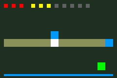

# Evidências — Tutorial manual, versão 0.3.0

24 de outubro de 2026. ROMs executadas no mGBA 0.10.5 / libretro. Hardware físico não testado.

O [relatório das quatro etapas](report.json) identifica cada ROM. O [relatório de reconstrução do artigo](article-report.json) registra a montagem em uma pasta vazia com apenas os três arquivos apresentados no texto e a igualdade byte a byte com a etapa 4.

A etapa 4 tem 2.112 bytes. A partida somente por controle construiu uma torre, eliminou quatro inimigos, ganhou 20 moedas e manteve os três pontos da base. Depois atravessou o portal para vencer. O teste também verificou derrota sem torre e reinício. A contagem de escritas de estado nesse percurso foi zero.



[Etapa 1](step-1.png), [etapa 2](step-2.png), [etapa 3](step-3.png), [etapa 4](step-4.png) e [vitória](win.png).

Os quinze grupos da campanha de dez mapas continuaram passando. Sua ROM permanece idêntica à versão 0.2.0: 22.520 bytes e SHA-256 `96e8e02ae5e066ed0765a75814b7d418a0ea0dbbf9a2527318679e3141e3a3aa`. O novo caminho de aprendizado não depende do gerador de mapas nem de recursos gráficos dessa campanha.

Para repetir:

```sh
make emulator
make verify
```

O preenchimento completo da tela no início/reinício leva mais de um frame. O teste de uma atualização por frame refere-se ao laço normal, depois dessa preparação.

A [execução no Ubuntu 24.04](https://github.com/AlanHJH/gba-assembly-ai/actions/runs/40072846180) passou com as quatro ROMs, a campanha completa e a reconstrução do artigo. O [registro de CI](ci.json) identifica o commit e o SHA-256 da ROM didática, coincidente com o local.

## Publicação no blog

O [artigo em produção](https://alanjahnel.dev/game-boy-advance-assembly-do-zero) foi conferido por HTTP e no navegador. Os 17 blocos de código são idênticos aos do tutorial testado; duas tabelas renderizaram e a imagem carregou. A home, sitemap, SEO, previews e seis identificações de crawler passaram no smoke de produção. O [registro JSON](publicacao.json) identifica o commit do site, CI e download público do kit; a [captura](artigo-producao.png) mostra a página publicada.
