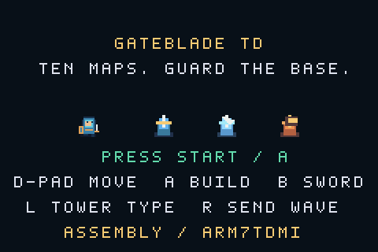

# Evidências — Gateblade TD v0.2.0

Resultados de 24 de outubro de 2026. A ROM foi executada no núcleo libretro do mGBA 0.10.5, construído do arquivo oficial cujo hash é conferido pelas ferramentas do projeto.

## Artefato e resultado

| Item | Valor |
| --- | --- |
| ROM | `gateblade-v0.2.0.gba` |
| Tamanho | 22.520 bytes |
| SHA-256 | `96e8e02ae5e066ed0765a75814b7d418a0ea0dbbf9a2527318679e3141e3a3aa` |
| Execução | mGBA 0.10.5 / libretro |
| Hardware físico | Não testado |

O [relatório](report.json) identifica tamanho, SHA-256 e os quinze grupos de teste. O [registro integral de botões](playthrough.json) preserva as entradas e os intervalos dos trechos da demonstração. A BSS própria do jogo mede 1.008 bytes; não é medida de todo o uso de memória do GBA.

A campanha atravessou dez mapas, concluiu vinte ondas e chegou à vitória em **15.907 frames emulados**, com **146 eliminações, zero escapes e 590 moedas**. A gravação mantém mais 120 frames na tela final. A campanha não escreve no estado do jogo; o frontend confere essa contagem e o teste repete os botões desde um novo boot. Cenários isolados, por outro lado, preparam condições em EWRAM deliberadamente para isolar regras.

A montagem, a geração de cabeçalho e a execução foram verificadas separadamente. Não foi fornecida BIOS externa. **Não houve teste em console físico** nem sessão manual de teclado nesta etapa.

## Capturas inspecionadas

| Situação | Captura |
| --- | --- |
| Título e controles | [title.png](title.png) |
| Tutorial preparado | [map-01.png](map-01.png) |
| Frost Pass | [map-03.png](map-03.png) |
| Ember Steps | [map-06.png](map-06.png) |
| Warden Keep | [map-10.png](map-10.png) |
| Defesa com FROST disponível | [battle-03-1.png](battle-03-1.png) |
| Defesa com BLAST disponível | [battle-06-1.png](battle-06-1.png) |
| Guardião na última onda | [battle-10-3.png](battle-10-3.png) |
| Tutorial concluído, portal verde | [clear-01.png](clear-01.png) |
| Vitória da campanha | [victory.png](victory.png) |



O vídeo contém trechos do tutorial, das fases 3 e 6, da fase 10 e da vitória. São 626 quadros, aproximadamente 62,886 segundos, capturados a cada seis frames durante os trechos selecionados. Os cortes são registrados em `demo_clips`; não se trata de um vídeo integral da partida. O MP4 é ampliado para 720 × 480, o GIF para 480 × 320. Não há áudio na demonstração; a geração de amostras PSG é verificada separadamente pelo teste.

## Reproduzir

```sh
make emulator
make verify
make demo
make package
```

Os resultados novos ficam em `build/test-results/`. Esta pasta preserva a seleção estável da versão 0.2.0. A [versão 0.1.0](../2026-10-23/README.md) mantém suas próprias evidências.

A [release v0.2.0](https://github.com/AlanHJH/gba-assembly-ai/releases/tag/v0.2.0) distribui ROM, checksum, MP4 e artigo exportado. A [execução de CI](https://github.com/AlanHJH/gba-assembly-ai/actions/runs/40062903449) passou no Ubuntu 24.04 e produziu o mesmo SHA-256 local. O [registro de CI](ci.json) identifica o commit testado e a comparação. O [registro da publicação](release.json) confirma a release pública com cinco arquivos. ROM, checksum e artigo foram baixados sem autenticação, retornaram HTTP 200 e coincidiram byte a byte com os pacotes locais; referências versionadas de imagem e relatório também responderam HTTP 200.
